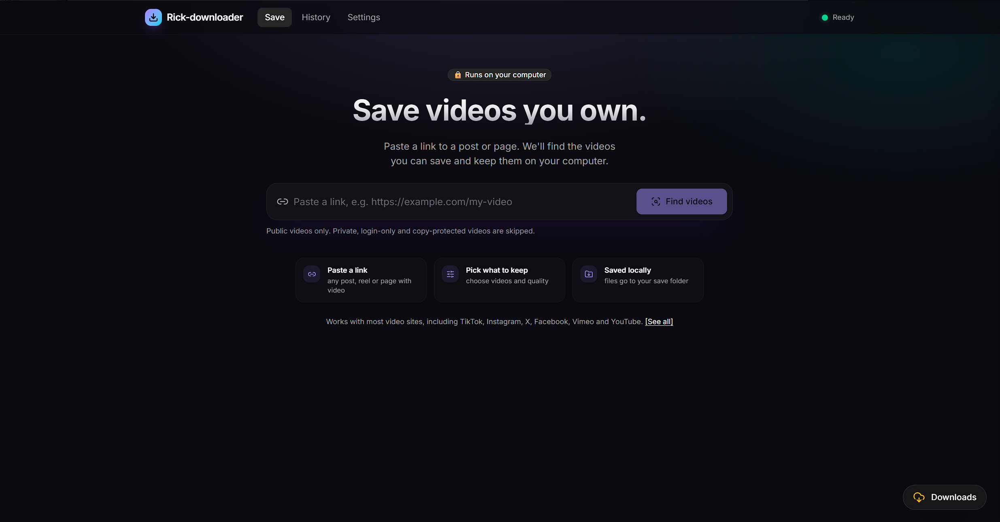

# Rick-downloader

**A self-hosted media archiver for your own content.** Paste a page URL, see which videos on it can be saved, and archive the ones you choose to your own disk, with a live job queue and a searchable history.

It's also a full-stack engineering project: a typed Next.js front end talking to a Python worker over REST and Server-Sent Events, with real attention to security (SSRF protection, no shell execution, path-traversal guards) and to being a polite client to the sites it talks to.

> **Responsible use.** Rick-downloader is meant for archiving **content you own or have permission to save**, such as your own uploads, Creative Commons media, or public-domain footage. It runs only on your own machine, works only with publicly accessible videos, and **never bypasses DRM, paywalls, logins, or other access controls**. Respect each site's terms of service and copyright law where you live.



---

## Engineering highlights

| Area | What's interesting |
|---|---|
| **Architecture** | Two services: a Next.js 15 App Router UI and a FastAPI worker, connected through Next.js rewrites. The worker is never exposed to the host network. |
| **Real-time UX** | Job progress, speed, ETA, queue position and host status stream over **Server-Sent Events**, with auto-reconnect and a resync on reconnect. |
| **Concurrency** | An asyncio job queue with a global concurrency limit **plus per-host limits**. Blocking downloads run in a thread pool, and slots are released during retry backoff so one slow host can't block the others. |
| **Security** | **SSRF guard** on every user URL, every discovered link and every redirect hop (IPv4 + IPv6, including mapped and odd numeric forms). **No shell execution**: the media engine is used as a library, enforced by an AST check in CI. **Path-traversal-safe** file serving by job ID only. |
| **Polite client** | Per-host request spacing, at most one request at a time to rate-sensitive hosts, exponential backoff on HTTP 429, and a visible cooldown instead of hammering the site. |
| **Error design** | Raw extractor errors are mapped to clear categories (private / login required, age-restricted, unavailable, protected, unsupported, rate-limited). Technical details are kept behind a toggle. |
| **Type safety** | Pydantic on the backend and Zod on the frontend mirror one API contract. TypeScript strict, mypy and ruff are clean. |
| **Testing** | pytest (URL guard, queue and backoff, path traversal, error mapping), vitest (UI states), and Playwright end-to-end (scan, download, history). |
| **Built with AI tooling** | Spec-driven development with Google Antigravity: a written spec, always-on project rules and phased workflows, with every phase verified by tests before moving on. |

---

## Features

- **Page scanning**: detects downloadable videos using [yt-dlp](https://github.com/yt-dlp/yt-dlp)'s extractors, with an HTML fallback (`<video>`, `<source>`, `og:video`, direct media links, embeds) for unknown sites.
- **Selective archiving**: a card grid with select-all and a quality choice per item (Best, 1080p, 720p, Audio only, Source).
- **Job queue**: concurrent downloads (1–5) with live progress, cancel (partial files are cleaned up) and retry.
- **History**: everything is kept in SQLite. Re-download, open, or delete a record with or without its file.
- **Transparent status**: every job says what it's doing and why it's waiting ("Waiting, 2 ahead"), kept separate from real errors.
- **Access-aware**: private, login-only, age-restricted and DRM-protected media are detected, clearly labelled, and skipped.
- **Optional session cookies**: for sites where *your own* account needs to be signed in to see *your own* content.

## Tech stack

| Layer | Tech |
|---|---|
| Web UI | Next.js 15 (App Router), TypeScript (strict), Tailwind CSS, shadcn/ui, TanStack Query, Zod |
| Worker | Python 3.12, FastAPI, SQLModel + SQLite, httpx, selectolax, yt-dlp (as a library) |
| Media | ffmpeg (muxing, audio extraction), Deno (JS runtime required by some extractors) |
| Runtime | Docker Compose (`web` + `worker`) |
| Tests | pytest, vitest, Playwright |

```
Browser ──▶ web (Next.js, 127.0.0.1:3000) ──/api/* rewrite──▶ worker (FastAPI, internal network only)
   ▲                                                              │
   └────────────── SSE: job + host status events ◀────────────────┤
                                                                  ├─▶ media engine + ffmpeg ──▶ ./downloads
                                                                  └─▶ SQLite ──▶ ./data
```

---

## Installation

All three platforms run the same way: **Docker runs the app**, so you don't need Python, Node, or ffmpeg installed to *use* it. Those are only needed for local development (see [Development](#development)).

**What you need on every OS:** Docker (Desktop on Windows/macOS, Engine on Linux) with the Compose plugin, Git, and about 3 GB of free disk space plus room for your videos.

### Windows 10/11

1. Install the tools in **PowerShell** (accept the prompts):
   ```powershell
   winget install --id Git.Git -e
   wsl --install                      # Docker needs WSL2; skip if you already have it
   winget install --id Docker.DockerDesktop -e
   ```
2. **Restart your PC**, open **Docker Desktop** once, and wait for "Engine running".
3. Get the app and start it:
   ```powershell
   git clone https://github.com/rickavila296/rick-downloader.git rick-downloader
   cd rick-downloader
   copy .env.example .env
   docker compose up -d --build
   ```

### macOS (Apple Silicon or Intel)

1. Install [Homebrew](https://brew.sh) if you don't have it, then in **Terminal**:
   ```bash
   brew install git
   brew install --cask docker         # Docker Desktop
   ```
2. Open **Docker Desktop** from Applications once, grant the permissions it asks for, and wait for "Engine running".
3. Get the app and start it:
   ```bash
   git clone https://github.com/rickavila296/rick-downloader.git rick-downloader
   cd rick-downloader
   cp .env.example .env
   docker compose up -d --build
   ```

On Apple Silicon (M1–M4) the images build natively for arm64, so you don't need any extra flags. If a build ever complains about the platform, add `platform: linux/arm64` under the service in `docker-compose.yml`.

### Linux (Ubuntu/Debian; other distros are similar)

1. Install Docker Engine + Compose plugin and Git:
   ```bash
   sudo apt update
   sudo apt install -y git ca-certificates curl
   curl -fsSL https://get.docker.com | sudo sh      # official convenience script
   sudo usermod -aG docker $USER                    # run docker without sudo
   ```
   **Log out and back in** (or run `newgrp docker`) so the group change applies. On Fedora use `sudo dnf install git docker-ce docker-compose-plugin`; on Arch use `sudo pacman -S git docker docker-compose`. Then run `sudo systemctl enable --now docker`.
2. Check it works: `docker run --rm hello-world`
3. Get the app and start it:
   ```bash
   git clone https://github.com/rickavila296/rick-downloader.git rick-downloader
   cd rick-downloader
   cp .env.example .env
   docker compose up -d --build
   ```

On Linux, files in `./downloads` may be owned by root, because the container writes them. To fix that, set `user: "${UID}:${GID}"` on the worker service, or run `sudo chown -R $USER: downloads data` once.

### After installing (all platforms)

- Open **http://localhost:3000** and check the System Status cards: Worker **Online**, a yt-dlp version, and ffmpeg **Found**.
- Stop the app: `docker compose down`. Start it again: `docker compose up -d`.
- Your videos are saved in `./downloads`, and history is kept in `./data`. Both survive restarts and updates.

---

## Usage

1. Paste a page URL and click **Scan**.
2. Tick the videos you want (or **Select all**), choose a quality, and click **Download selected**.
3. Watch progress in the **Downloads** drawer. Finished files are saved in `./downloads`.
4. Use **History** to re-download, get the file, or clean up.

### What can't be downloaded

Rick-downloader can only download what a **logged-out visitor** can watch. You'll get a clear message instead of a download when a video is:

| Situation | What you'll see |
|---|---|
| Private, friends-only, members-only, or unlisted-behind-login (any site) | **"Private or requires login"**. Only public videos can be downloaded. |
| Age-restricted | **"Age-restricted video"**. Needs a signed-in account. |
| Deleted, removed, or blocked in your region | **"Video unavailable"** |
| DRM-protected (Netflix, Disney+, most paid streaming) | **"Protected, can't download"**. This is never bypassed. |
| From a site yt-dlp doesn't support and with no video in its HTML | **"This site isn't supported"** |
| Temporarily rate-limited by the site | **"Taking a short break"** banner with a countdown. Retries automatically. |

The raw technical error is always available under **"Show technical details"** on the job, if you need it for debugging.

> A cookies file (below) only lets the app see what **your own signed-in account** can already see. It isn't a way around privacy settings, and it never unlocks DRM.

### Cookies (optional, for sign-in-required sites)

Some sites show certain content only to signed-in users, and some ask you to sign in to confirm you're a person. If the content is **your own** (or your account already has access to it), you can give the app a session:

1. Use a **spare account**, not your main one. Accounts used with downloaders can get flagged.
2. Open a private/incognito window, log in to the site, and export its cookies in **Netscape format** with a browser extension such as "Get cookies.txt LOCALLY".
3. Save the file as `secrets/cookies.txt`, then close the incognito window **without logging out**.
4. Restart: `docker compose up -d`. Settings will show **Cookies: loaded**.

`secrets/` is git-ignored and mounted read-only. Treat `cookies.txt` like a password: anyone who has it is logged in as that account. Cookies expire, so re-export when sign-in errors come back.

### Rate limits

Some platforms limit how often one IP address can fetch media. Rick-downloader is built to stay within those limits: rate-sensitive hosts run one job at a time, requests are spaced out, and an HTTP 429 triggers a visible cooldown with automatic retry. If you see the **"Taking a short break"** banner:

- let the countdown finish, since it retries by itself
- turn off any VPN or shared network
- if it keeps happening, wait a few hours

---

## Configuration

Set these in `.env`:

| Variable | Default | What it does |
|---|---|---|
| `DOWNLOAD_DIR` | `./downloads` | Where files are saved |
| `DB_PATH` | `./data/rick-downloader.db` | SQLite database (jobs, scans, history) |
| `MAX_CONCURRENT` | `2` | Parallel downloads (1–5; also set in Settings). Rate-sensitive hosts are capped at 1. |
| `MAX_ENTRIES` | `200` | Max videos returned by one scan |
| `MAX_FILESIZE_MB` | `4096` | Downloads larger than this are refused |
| `COOKIES_FILE` | `./secrets/cookies.txt` | Optional cookies file |
| `APP_TOKEN` | *(empty)* | If set, API requests need `X-App-Token`. Only set it if you expose the app beyond your own PC |
| `WORKER_URL` | `http://worker:8000` | Where the web app forwards `/api/*` |

---

## Security model

This is a **single-user tool for your own machine**. It was built with these guarantees:

- **Local only**: the web UI binds to `127.0.0.1:3000`, and the worker port is never published to your network.
- **No shell commands**: yt-dlp runs as a Python library. No `subprocess`, `os.system`, or `shell=True` anywhere in the worker (enforced by `scripts/check-security.py`).
- **SSRF protection**: every URL, including links found inside scanned pages and every redirect hop, is checked against private, loopback, link-local, reserved and multicast addresses (IPv4 and IPv6) before it's fetched.
- **Safe files**: filenames are sanitized, saved files can't land outside `DOWNLOAD_DIR`, and files are served by job ID only, never by a path from the browser.
- **Fixed presets**: quality presets map to fixed yt-dlp options on the server, and the browser can't pass raw yt-dlp flags.
- **No secret leakage**: cookies and headers are never logged or returned by the API.

Don't expose this app to the internet.

---

## Development

Install the dev tools: **Node 20+**, **pnpm**, **uv** (Python 3.12), and **ffmpeg**.

| OS | Command |
|---|---|
| Windows | `winget install OpenJS.NodeJS.LTS astral-sh.uv Gyan.FFmpeg` then `npm i -g pnpm` |
| macOS | `brew install node uv ffmpeg pnpm` |
| Linux (Ubuntu) | `sudo apt install -y ffmpeg nodejs npm && npm i -g pnpm && curl -LsSf https://astral.sh/uv/install.sh \| sh` |

Set up the dependencies once: `cd apps/worker && uv sync && cd ../..` and `pnpm install`.

**Worker checks (from the repo root):**

```bash
# macOS / Linux
apps/worker/.venv/bin/pytest apps/worker/tests
apps/worker/.venv/bin/ruff check apps/worker
apps/worker/.venv/bin/mypy --config-file apps/worker/pyproject.toml apps/worker/app
apps/worker/.venv/bin/python scripts/check-security.py
```

```powershell
# Windows (PowerShell)
apps\worker\.venv\Scripts\pytest apps\worker\tests
apps\worker\.venv\Scripts\ruff check apps\worker
apps\worker\.venv\Scripts\mypy --config-file apps\worker\pyproject.toml apps\worker\app
apps\worker\.venv\Scripts\python scripts\check-security.py
```

```bash
# Any OS: inside the running container (use python -m, not uv run)
docker compose exec worker python -m pytest -q
```

**Web checks (any OS):**

```bash
pnpm --filter web typecheck
pnpm --filter web lint
pnpm --filter web test
pnpm --filter web exec playwright test
```

### Project structure

```
rick-downloader/
├─ apps/
│  ├─ web/        # Next.js UI: app/ (Scan, History, Settings), components/, lib/ (api, schemas)
│  └─ worker/     # FastAPI: security/ (url_guard, cookies, host_limiter, rate_limiter),
│                 # scanner/ (yt-dlp + HTML), jobs/ (queue, runner, presets, events), routes/
├─ scripts/check-security.py
├─ docker-compose.yml
└─ .env.example
```

---

## Troubleshooting

| Problem | Fix |
|---|---|
| A site suddenly stops working | Update yt-dlp: `docker compose build --no-cache worker` and then `docker compose up -d`. This fixes most problems. |
| "Sign in to confirm you're not a bot" | The site is rate-limiting you. Wait for the cooldown, turn off your VPN, and refresh `secrets/cookies.txt` if you use one. |
| "Private or requires login" on your own video | Check the video's privacy setting on the site. If it's meant to stay private, add a cookies file from your own account. |
| ffmpeg shows "Not found" | Rebuild the worker image: `docker compose build worker`. |
| Downloads stuck at "Queued" | Read the job's status line in the drawer (rate-sensitive hosts run one at a time). Then check `docker compose logs worker --tail 80`. |
| `uv run` fails with "Permission denied" in the container | Use `docker compose exec worker python -m <tool>` instead. |
| History is empty after a restart | Check that `DB_PATH` points inside the `./data` volume in `docker-compose.yml`. |
| Docker: "WSL 2 installation is incomplete" | Run `wsl --update`, then restart Docker Desktop. |
| **macOS:** "Cannot connect to the Docker daemon" | Open Docker Desktop and wait for "Engine running". |
| **macOS:** slow downloads or builds | In Docker Desktop → Settings → Resources, give it at least 4 GB of RAM. |
| **Linux:** "permission denied … docker.sock" | `sudo usermod -aG docker $USER`, then log out and back in. |
| **Linux:** can't delete files in `downloads/` | `sudo chown -R $USER: downloads data` (see the Linux install notes). |
| Port 3000 already in use (any OS) | Change `127.0.0.1:3000:3000` to e.g. `127.0.0.1:3100:3000` in `docker-compose.yml`, then open http://localhost:3100. |

---

## Maintenance

- **Monthly:** `docker compose build --no-cache worker` to pick up a fresh yt-dlp.
- **If you use a cookies file:** re-export it when sign-in errors come back, because sessions expire.
- **Occasionally:** clear old files from `./downloads` with History → Delete → record + file.

## Roadmap

- [ ] Subtitles download
- [ ] "Send to Rick-downloader" bookmarklet
- [ ] n8n webhook to queue downloads from automations
- [ ] Optional Supabase history sync


## Acknowledgements

Media extraction is powered by [yt-dlp](https://github.com/yt-dlp/yt-dlp) and [ffmpeg](https://ffmpeg.org). This project is not affiliated with any video platform.

## License

[MIT](./LICENSE) for the code. The license covers this software only. It grants no rights to any media you download with it.
